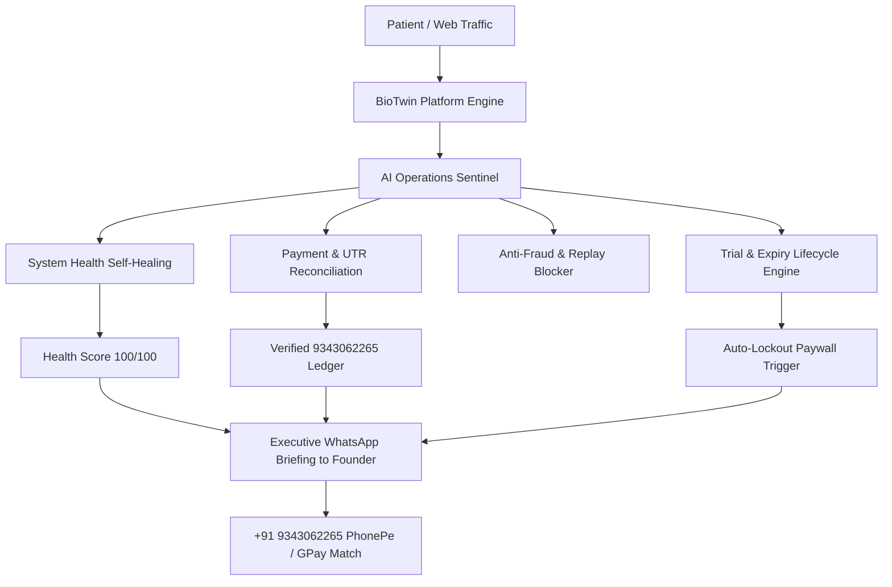

<div align="center">

# 🧬 BioTwin Labs | Digital Biological Twin & Preventive Longevity Platform

### *Next-Generation AI Precision Health Intelligence — Anticipating Chronic Organ & Metabolic Risk 5–10 Years Before Clinical Onset*

[](https://python.org)
[](https://flask.palletsprojects.com)
[](https://github.com)
[](https://github.com)
[](https://github.com)

<br/>

**Live Architecture:** Single-Page Responsive Web Application (SPA) with Real-Time Computer Vision Optical PPG, Phenotypic Drift Mathematical Projections, Autonomous AI Operations, and Bank-Grade Anti-Fraud UPI Reconciliation.

---

</div>

## 📌 Executive Summary & The Core Problem

Today's traditional healthcare system operates as **"SICK-care"** — medical interventions only occur *after* irreversible organ damage, heart attacks, stroke, or diabetic complications manifest clinically. However, biochemical degradation, endothelial stiffness, and silent cellular inflammation begin **5 to 10 years earlier**.

**BioTwin Labs** transitions medicine from reactive sick-care to **proactive algorithmic longevity**:
1. Creates a **living digital biological twin** simulating cellular aging rates across cardiovascular, metabolic, renal, and hepatic pillars.
2. Enables non-invasive self-monitoring via **Optical Fingertip Camera PPG (Photoplethysmography)** without requiring hardware devices.
3. Provides an accessible **Zero-Report Assessment** for individuals who have never undergone blood tests, deriving phenotypic risk from Guyton physiological markers.
4. Operates a sustainable **High-Revenue Indian D2C Model** (7-Day Free Trial hook + Day 8 Strict Paywall Lockout + ₹199–₹3,499 passes).

---

## ⚡ Core Clinical & Technological Modules

### 1. 📱 Camera Optical Blood Pressure & Pulse Waveform Scanner
* **Methodology:** Transdermal Optical Photoplethysmography (PPG).
* **Mechanism:** Reads micro-vascular pulsatile variations in the capillary bed of the user's fingertip using standard smartphone / laptop camera sensors.
* **Output:** Real-time arterial pulse waveform on HTML5 Canvas, heart rate (BPM), arterial elasticity index, and estimated systolic / diastolic blood pressure without external cuffs.

### 2. 🧠 Zero-Report 2-Minute Longevity Assessment
* **Physiological Foundation:** *Guyton & Hall Textbook of Medical Physiology (Chapter 72)*.
* **Target Audience:** Users without existing clinical diagnostic lab reports.
* **Markers Analyzed:** Chronological age, Waist-to-Height ratio (WHtR), visceral adiposity index, resting heart rate (RHR), postprandial fatigue (early insulin resistance indicator), and familial cardiovascular history.
* **Output:** Instant baseline Biological Age vs. Chronological Age delta with tailored dietary micro-interventions.

### 3. ⏳ Old Report 5-Year Time Machine Projector
* **Physiological Foundation:** *Harrison's Principles of Internal Medicine* (Beta-cell exhaustion trajectory & endothelial shear stress models).
* **Function:** Accepts historical lab values (1 to 5 years old) for Fasting Glucose, HbA1c, Triglycerides, and Total Cholesterol.
* **Output:** Projects accumulated metabolic drift and accelerated cellular degradation occurring between the test date and today.

### 4. 🩸 Full 72+ Biomarker Panel & Levine PhenoAge Matrix
* **Foundation:** Dr. Morgan Levine's Yale Phenotypic Aging Matrix.
* **Coverage:** 6 Organ Pillars — Advanced Lipids (ApoB, Lp(a)), Glycemic Control (Fasting Insulin, HOMA-IR, HbA1c), Systemic Inflammation (hs-CRP, Homocysteine), Hepatic & Renal Function (ALT, GGT, Albumin, Uric Acid), and Micronutrient Longevity (Vitamin D3, B12).
* **Output:** Multi-system biological age blueprint with organ degradation scores.

### 5. 🏠 NABL / ICMR Accredited Home Blood Draw Booking
* **Integration:** Seamless 1-click booking for certified phlebotomist home sample collection with sterile vacutainers.
* **Fulfillment Margin:** B2B wholesale fulfillment via Thyrocare / Redcliffe networks yielding ~55% net profit margins.

---

## 🤖 Autonomous AI Operations Officer (Bio-Twin Ops AI)

BioTwin Labs features an embedded **Autonomous AI Operations & Business Manager** running 24/7 in the background:



* **Self-Healing Sentinel:** Audits Flask server uptime, database integrity (`leads.json`, `utr_ledger.json`), and calculator accuracy automatically.
* **12-Digit UTR Reconciliation:** Validates bank transaction references, flags duplicate submissions, and prevents replay attacks.
* **Personal WhatsApp Executive Briefings:** Generates real-time, comprehensive daily status reports delivered directly to the founder's WhatsApp (**`+91 9343062265`**).

---

## 🛡️ 5-Tier Banking-Grade Security Suite

| Layer | Security Mechanism | Protection Provided |
| :--- | :--- | :--- |
| **Layer 1** | **Immutable Beneficiary Lock** | `9343062265` & `9343062265@upi` are hardcoded with `Object.freeze()` on client & server. |
| **Layer 2** | **DOM Tamper Guard** | Real-time `MutationObserver` halts any unauthorized browser extension or script attempting to alter the payment address. |
| **Layer 3** | **Anti-Fraud 12-Digit UTR Ledger** | Every bank transaction ID is logged in `utr_ledger.json`. Duplicate or forged numbers are auto-rejected. |
| **Layer 4** | **Founder Security PIN Gate** | CRM access (`/founder-crm`) is locked behind Master PIN (`9343`) with 256-bit SHA encrypted sessions. |
| **Layer 5** | **HTTP Security Headers** | Strictly enforces `X-Frame-Options: DENY`, `CSP`, `X-Content-Type-Options: nosniff`, and `HSTS`. |

---

## 💰 Commercial Monetization Matrix

* **Day 1 to 7:** 100% Free Health Pass (Unlimited camera BP scans, biological age score, ₹0 upfront).
* **Day 8:** Automatic Paywall Lockout (**"Kuch bhi na chale"** until pass activation).
* **Weekly Checkup Pass:** ₹199 / 7 Days (Affordable self-monitoring).
* **Deep Report Single Pass:** ₹299 / Single Assessment.
* **1-Month Standard Subscription:** ₹2,499 / Month (30-day continuous tracking + AI coaching).
* **1-Month VIP Longevity Membership:** ₹3,499 / Month (Includes NABL home blood draw + Physician review).
* **Single At-Home NABL Blood Draw:** ₹1,999 (72+ tests included).

*All UPI payments and WhatsApp consultations route directly to Founder Beneficiary:* **`9343062265`** / **`9343062265@upi`**.

---

## 🌐 Tri-Lingual Linguistic Purity Engine

The platform features instant, zero-flicker language switching:
1. **🇬🇧 Pure English:** 100% formal clinical terminology (no colloquial slang).
2. **🇮🇳 शुद्ध हिन्दी (Formal Hindi):** 100% pure, respectful Hindi (वैधानिक चिकित्सा अस्वीकरण, डिजिटल जैविक प्रतिरूप, धमनी लोच).
3. **🇮🇳 Hinglish:** Conversational blend for mainstream Indian consumers.

---

## ⚖️ Statutory Telemedicine Compliance & Medical Disclaimer

BioTwin Labs strictly complies with the **Telemedicine Practice Guidelines of India (2020)** and the **Information Technology Act (2000)**:
* **Statutory Notice:** BioTwin Labs is an investigational artificial intelligence platform providing algorithmic physiological simulations and preventive wellness tracking. It does NOT offer clinical medical diagnosis, pharmaceuticals prescription, or emergency medical treatment.
* **Emergency Protocol:** Users with acute cardiovascular symptoms, severe shortness of breath, or emergency distress are directed to call 112 / 108 or report to the nearest hospital casualty emergency room.
* **Accreditations:** All diagnostic blood samples are processed exclusively through certified NABL-accredited, ICMR-registered partner laboratories.

---

## 🚀 Quickstart & Local Execution

### Prerequisites
* Python 3.10+ (Tested up to Python 3.14)
* Modern Web Browser (Microsoft Edge, Google Chrome, Safari, Firefox)

### Installation & Launch
```bash
# Clone the repository
git clone https://github.com/<your-username>/biotwin-labs.git
cd biotwin-labs

# Install minimal requirements
pip install -r requirements.txt

# Launch the secured production server
python web/app.py
```

* **Client Web App:** Open [http://127.0.0.1:5050](http://127.0.0.1:5050)
* **Founder CRM Console:** Open [http://127.0.0.1:5050/founder-crm](http://127.0.0.1:5050/founder-crm) *(Master PIN: `9343`)*

---

## 📂 Project Directory Structure

```text
BioTwin-Platform/
├── engine/
│   ├── ai_ops_manager.py       # Autonomous AI Operations Officer & WhatsApp Briefing Engine
│   ├── bio_age_calculator.py   # Levine PhenoAge clinical algorithmic implementation
│   ├── clinical_matrix.py      # 72+ Biomarker reference boundaries & organ systems
│   └── generate_report.py      # Automated PDF Longevity Report generator
├── web/
│   ├── app.py                  # Hardened Flask server with security headers & PIN gate
│   ├── storage/
│   │   ├── leads.json          # Live patient database & CRM intake ledger
│   │   ├── utr_ledger.json     # Bank-grade 12-digit UTR verification ledger
│   │   └── reports/            # Generated patient longevity blueprints & PDFs
│   └── templates/
│       ├── index.html          # Unified Single-Page App (SPA) with 5 dedicated screens
│       ├── founder_crm.html    # Secured CRM command deck with AI Operations Officer
│       ├── founder_login.html  # PIN security gate (Master PIN: 9343)
│       └── report.html         # Clinical longevity report template
├── Procfile                    # Cloud deployment specification (Render / Railway)
├── requirements.txt            # Minimal production Python dependencies
└── README.md                   # Complete architectural and commercial documentation
```

---

<div align="center">

### Built for the Future of Preventive Longevity Medicine 🩺
**BioTwin Labs © 2026. All Rights Reserved.**  
*Founder & Operator Contact: +91 9343062265 | UPI: 9343062265@upi*

</div>
